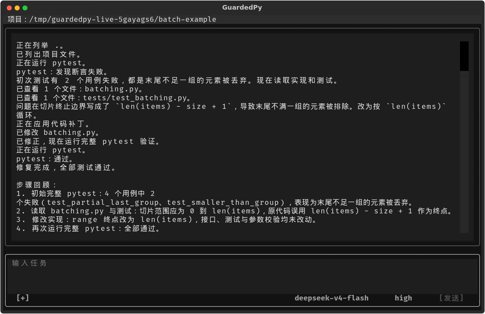

# GuardedPy

GuardedPy 是面向小型 Python + pytest 项目的终端编程 Agent。你描述问题和预期行为，它通过 DeepSeek 分析代码，在本机修改文件、运行测试，并根据执行结果继续修复。任务进展、工具调用和测试反馈都显示在同一终端中。

<p align="center">
  
</p>

上图来自一次真实的 DeepSeek 会话：`chunks` 函数遗漏了末尾不足一组的元素，Agent 修改实现后通过了全部四个测试。

## 工作方式

GuardedPy 将代码修复组织成连续的“读取、修改、验证”过程：

- **基于当前文件修改。** 修改已有文件前，Agent 在当前任务中完整读取它；应用补丁时，程序核对读取记录与磁盘内容，让补丁对应同一版本的代码。
- **用完整测试确认结果。** 定向测试帮助定位问题。通过补丁或删除工具改动文件后，当前任务需要通过完整 pytest 才能以完成状态结束。
- **在执行过程中协作。** 运行中可以补充要求、排队后续任务或中断执行；删除文件和运行项目 Python 程序由你逐次审批。会话自动保存，便于继续同一个问题。

也可以先用 `/plan` 分析方案，或用 `/review` 审查代码。这两种模式只读取文件和 Git 信息，适合在修改前了解实现与测试覆盖。

项目支持 `src/` 布局、根目录 Python 模块和包，以及 pytest 配置指定的测试目录。GuardedPy 使用目标项目的 Python 环境，适合已有本地依赖、能够通过 pytest 描述预期行为的项目。

## 开始使用

准备 Linux 或 WSL、Python 3.11+、Git，以及一个包含源码和 pytest 测试的项目。真实任务需要 DeepSeek API Key、到 `https://api.deepseek.com` 的网络连接和可用的系统 keyring。WSL 中可将项目放在 `~/projects` 等 Linux 文件系统目录。

### 1. 安装到项目环境

将 GuardedPy 源码克隆到固定位置：

```bash
mkdir -p ~/projects
git clone https://github.com/WalnuTpz/guardedpy.git ~/projects/guardedpy
```

进入准备处理的项目，激活已装好项目依赖的虚拟环境，再安装 GuardedPy。把下面的项目路径替换为实际位置：

```bash
cd /path/to/python-project
source .venv/bin/activate
python -m pip install -e ~/projects/guardedpy
python -m pytest
guardedpy
```

新环境可先用 `python3 -m venv .venv` 创建，再激活并安装项目依赖。启动前的 pytest 用于查看现有测试状态，已有失败用例可以直接作为修复起点。

### 2. 连接模型

在界面输入 `/credentials`，将 DeepSeek API Key 填入掩码输入框，选择“更新”。凭据保存在当前用户的系统 keyring 中。Linux/WSL 的 Secret Service 后端需要可访问的 D-Bus 用户会话和已解锁的密钥环。

默认模型为 `deepseek-v4-flash`，思考强度为 `high`。任务文字、读取的代码和工具反馈发送给 DeepSeek；pytest 和获批的 Python 程序在本机以当前用户权限执行。

### 3. 提交任务

在主输入框描述问题，按 Enter 提交。例如：

```text
检查当前失败测试的原因，修复实现，保留函数签名和测试预期。修改后运行完整 pytest，说明原因和改动。
```

界面会显示执行进展和最终结果。任务结束后可以继续追问，或输入 `/exit` 回到终端检查文件。项目使用 Git 时，`git status --short` 列出改动文件，`git diff` 展示未暂存的已跟踪文件差异。

## 离线体验

安装后，在任意目录运行：

```bash
guardedpy demo
```

用方向键选择场景，按 Enter 启动。演示使用临时项目和预设模型响应，展示测试反馈修复、删除审批和过期审批处理；文件操作、测试与审批沿用实际执行流程，无需 API Key。

## 文档

| 文档 | 内容 |
| --- | --- |
| [入门教程](docs/getting-started.md) | 安装、准备密钥环，创建示例并完成一次真实修复 |
| [使用手册](docs/usage.md) | 接入项目、控制任务、管理会话与设置，以及使用纯文本模式 |
| [执行原理](docs/design.md) | 工具循环、文件版本、补丁写入、测试验证和上下文恢复 |

## 项目背景与许可证

GuardedPy 起源于智软训练营暑期学校期末项目，以 Python 代码修复为场景，探索文件操作、人工审批和测试反馈如何协同完成任务。

本项目采用 [MIT 许可证](LICENSE)。
