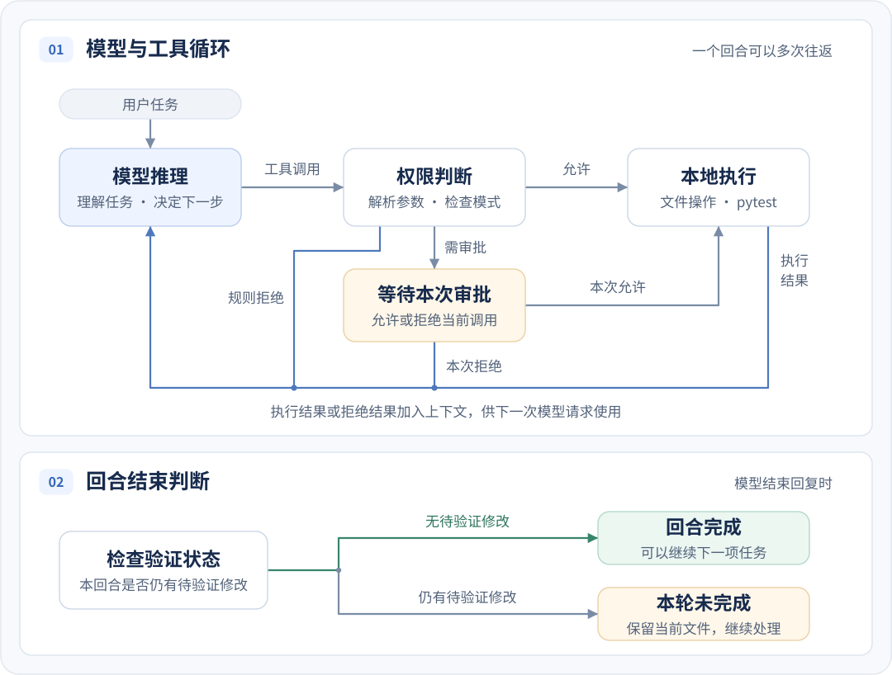
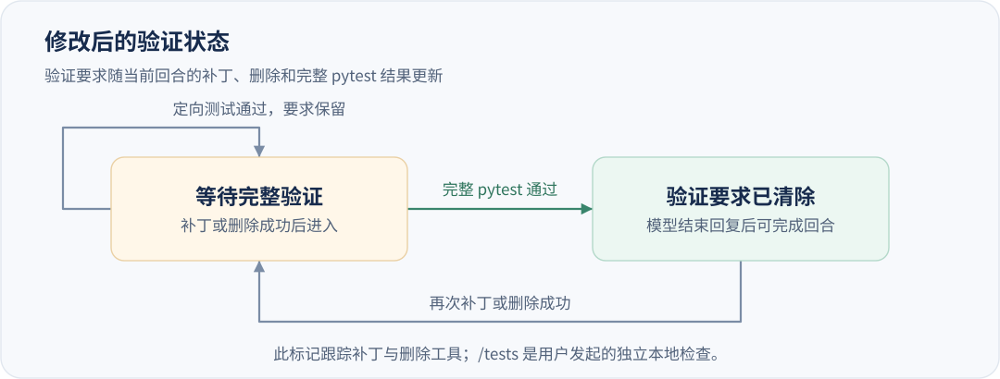

# GuardedPy 的执行原理

GuardedPy 把模型推理与本地执行连接起来：模型根据任务和已有反馈选择下一步，本地程序执行工具并将结果交回模型。围绕模型管理工具、上下文和任务状态的这一层称为 **harness**。它让一次代码修复可以经历多轮读取、修改和测试，也为界面提供可追踪的执行过程。

## 从任务到工具循环

**会话**保存连续对话的上下文。一次用户任务启动一个**回合**，回合包含模型回复、工具操作和中途补充的要求，直到完成、失败或中断。同一会话每次执行一个回合。

每次模型请求都带上任务、当前上下文和固定工具定义。模型可以返回文字，也可以提出工具调用。执行层解析参数，判断权限，执行获准的调用，再把结构化结果加入上下文。下一次模型请求据此决定继续操作还是结束回复。

  

例如，模型先请求源码和测试，随后提交补丁，再请求 pytest。测试失败时，反馈中的类型和失败位置成为下一次推理的输入。修复因而可以逐步收敛，而每一步都对应实际执行结果。

文字片段和工具调用都有独立的条目标识；事件携带会话、回合和顺序信息。终端界面据此合并流式文字、更新工具状态。交互界面和纯文本终端消费同一套事件，完成状态由执行循环统一决定。

## 固定工具与执行权限

模型使用八种工具。每种工具都有明确的参数结构，执行层先解析参数，再根据回合模式和文件范围作出决定。

| 工具 | 用途 | 普通回合 | 计划、审查回合 |
| --- | --- | --- | --- |
| `list_files`、`read_file` | 列出文件、分页读取文本 | 自动执行 | 自动执行 |
| `git_status`、`git_diff` | 查看 Git 状态与未暂存差异 | 自动执行 | 自动执行 |
| `apply_patch` | 修改或创建源码、测试文件 | 自动执行 | 拒绝 |
| `run_pytest` | 运行完整套件或指定测试节点 | 自动执行 | 拒绝 |
| `run_python` | 运行项目内的 Python 文件 | 本次审批 | 拒绝 |
| `delete_path` | 删除文件或空目录 | 本次审批 | 拒绝 |

计划和审查的只读性质由执行层检查每条调用来实现。pytest 在收集测试、运行 fixture 和测试函数时都会执行项目代码，因此它属于普通回合的执行工具。

文件工具使用项目相对路径。读取目标位于项目内，补丁作用于启动时识别的源码和测试目录；其中排除隐藏路径、`docs/`、`config/`、符号链接，以及 `README`、`README.md`、`pyproject.toml`、`setup.cfg`、`tox.ini` 等受保护文件。

pytest 和获批的 Python 程序以普通本机子进程运行，工作目录是项目根目录，解释器与 GuardedPy 相同，继承当前用户权限和环境。命令通过参数列表传入，使用 `shell=False`。项目代码在子进程中可以读写文件和访问网络；上面的权限判断作用于模型提出的工具调用。

任务文字、读取的代码、工具反馈和对话构成发送给 DeepSeek 的模型上下文。文件与测试操作在本机完成，API Key 在请求时从系统 keyring 取得并用于认证。

## 读取记录如何对应文件版本

补丁需要原文件的上下文来定位改动。GuardedPy 为当前回合记录读取覆盖范围和文件摘要，让模型读到的内容与随后修改的磁盘文件对应起来。

`read_file` 使用从零开始的行偏移，一页最多 200 行、32 KiB，返回下一页偏移、文件末尾标记和整个文件的 SHA-256。读取覆盖从开头连续到结尾，才形成完整读取记录。

假设一个文件有 240 行：先读取第 0–199 行，再从偏移 200 读取余下内容，两页摘要一致，就得到当前版本的完整读取记录。单独读取最后一页仅记录这部分内容；分页期间文件改变，已有进度失效，后续读取从新版本重新累计。

应用补丁前，执行层检查当前回合的完整读取记录、磁盘摘要和补丁上下文。尚未读完时返回需要读取的路径；摘要变化时返回内容已变化的结果。这些结果进入模型上下文，模型据此读取当前内容再生成补丁。

读取记录属于一个回合，也对应一个文件版本。修改后的文件再次被修改时，需要更新读取记录；下一回合也从当前磁盘内容重新读取。

## 补丁的准备与写入

GuardedPy 接收 unified diff 文本。文件头指定目标路径，每个 hunk 描述原内容中的保留、删除和新增行。修改已有文件时按上下文匹配生成新内容；创建文件使用 `--- /dev/null` 文件头，目标父目录需要已经存在。

一个补丁涉及多个文件时，执行层先检查全部路径、匹配各处上下文，并在内存中生成新内容。准备阶段完成后才开始写入，因此某个文件的上下文匹配失败时，其余文件仍保持原内容。

写入阶段在目标目录准备暂存文件和备份，保留原有文件权限，再逐个用 `os.replace` 替换目标。单个文件替换是原子操作，多文件更新依次进行。替换阶段出现 `OSError` 时，程序按相反顺序尝试恢复已替换文件，并清理暂存材料。

删除由独立的审批工具执行。成功的补丁和删除直接改变工作目录，随后测试失败或回合中断时，已完成的修改保留，供后续任务检查与继续处理。

## 测试反馈如何决定完成状态

`run_pytest` 可以运行完整 pytest，也可以指定测试路径或 node id，例如 `tests/test_pagination.py::test_exact_page`。定向运行每次最多接收 20 个节点，路径位于已识别的测试范围。完整运行从项目根目录执行当前解释器的 `-m pytest`，由 pytest 读取项目配置并收集测试。

执行层取得退出码、标准输出、标准错误和超时信息，将结果整理为五种反馈：

| 分类 | 含义 |
| --- | --- |
| `passed` | pytest 成功退出，报告中没有零测试收集的迹象 |
| `assertion_failure` | 失败摘要包含断言失败证据 |
| `collection_error` | 导入、语法或测试收集阶段发生错误 |
| `execution_error` | fixture、测试执行或命令执行失败 |
| `timeout` | 子进程超过执行时限 |

反馈包含可用的失败节点和最多 800 字符的输出摘录。节点归一化为项目内路径，可用于下一次定向测试。分类与位置帮助模型区分实现错误、收集错误和执行环境问题。

定向测试验证具体问题，完整测试检查修改对整个套件的影响。为此，回合单独记录“需要完整验证”状态：

  

成功的补丁或删除设置该状态，完整 pytest 通过后清除，再次修改重新设置。模型结束回复时，状态已经清除的回合可以完成；仍需要验证的回合以 `verification_required` 结束，并显示“本轮未完成：修改后尚未通过完整 pytest 验证”。模型的结束文字和程序的完成判定由此分开。

这个状态追踪补丁和删除工具的成功结果。`run_python` 返回程序输出与退出状态，程序内部的文件写入不设置验证标记。没有受跟踪修改的回合可以直接结束。

## 审批与中断如何保持上下文一致

需要审批时，循环暂停在具体工具调用上。审批记录绑定会话、回合、工具条目、规范化后的工具名与参数，以及审批标识。决定只处理一次，回合结束时其余审批记录随之终止。

允许后执行调用，拒绝后将拒绝结果交回模型。一条模型响应可能包含多个调用；处理审批后，本批其余调用收到 `not_executed_after_approval` 结果。下一次模型请求先看到审批结果和已发生的变化，再决定后续操作。

用户补充的要求在下一次模型请求前加入上下文。停止请求则把回合标记为取消，在模型流和工具调用边界处理；同步测试或 Python 子进程先返回或超时。结束回合时，循环为尚未完成的工具调用补上终止结果，保持模型历史中的调用与结果成对，供后续对话继续使用。

每回合最多处理 20 次模型响应、50 次工具调用。模型请求与本地命令默认超时为 120 秒。连接或超时故障出现在模型产生片段之前时，适配器额外尝试一次；已有片段后发生故障，则结束该请求。请求结束时关闭模型流和客户端。

## 保存什么，恢复什么

运行中的模型历史包含可见文字、工具调用与结果，以及模型隐藏推理。磁盘记录保留可继续阅读的对话和回合事实，使重新打开的会话能够恢复问题背景。

| 内容 | 保存与使用方式 |
| --- | --- |
| 用户、助手的可见文字 | 写入 SQLite，供界面显示历史消息 |
| 改动路径、最后一次测试分类、审批结果、终止状态 | 写成回合摘要，用于恢复模型背景 |
| 原始工具结果、模型隐藏推理 | 保留在当前进程的模型历史中 |
| 读取进度、待处理调用、审批、任务队列 | 属于当前执行状态 |

可见文字写入前会替换 `api_key`、`token`、`password` 等赋值形式、Bearer token 和 `sk-` 形式的凭据文本。普通文字及消息中引用的代码、差异随消息保存。

同一进程中切换回已经打开的会话，使用内存中的模型上下文。历史会话首次载入当前进程时，界面显示已保存的可见消息；模型背景由最近最多 24 条、合计 12,000 字符的消息，以及最近 16 个回合的摘要重建。数量限制作用于重建给模型的内容，数据库持续保留已追加的可见消息。

恢复后的模型可以从摘要得知改过哪些文件、测试结果如何。新的操作进入新回合，依据当前文件建立读取记录，并为需要审批的调用取得新的决定。历史记录提供任务背景，当前执行状态则描述正在发生的工作。
